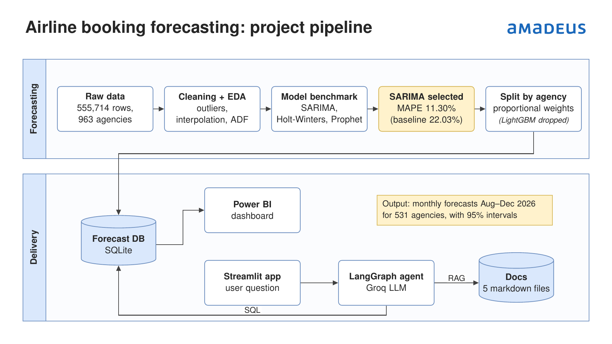

# Amadeus Forecasting

Prévision des réservations aériennes nettes (Air Net Bookings) des agences de voyage, et assistant
conversationnel qui répond aux questions sur ces prévisions.

> **Données non incluses.** Les données utilisées pendant le stage sont confidentielles : le dossier
> `data/`, les CSV de `outputs/`, la base SQLite et l'index Chroma ne sont pas publiés dans ce dépôt.
> L'application Streamlit s'exécute en local et n'est pas hébergée.



## Structure

| Dossier / fichier | Rôle |
|---|---|
| `main.py`, `src/` | Pipeline de prévision : nettoyage, SARIMA global, répartition par agence, exports Power BI |
| `outputs/` | CSV produits par le pipeline (`fait_reservations`, `dim_agence`, `fait_canal`) |
| `agent/database.py` | Charge les CSV dans la base SQLite `agent/amadeus_forecast.db` |
| `agent/rag.py` | Index Chroma de la documentation `agent/knowledge/*.md` (embeddings FastEmbed multilingues) |
| `agent/tools.py` | Outils de l'agent : SQL sur la base, recherche dans la documentation |
| `agent/graph.py` | Agent LangChain/LangGraph (LLM Groq `openai/gpt-oss-120b`) |
| `agent/app_web.py` | Interface web Streamlit |
| `agent/app.py` | Interface en ligne de commande |
| `tests/test_agent.py` | Contrôles hors ligne + 15 questions de référence |
| `powerbi/` | Dashboard Power BI : modèle `.pbit` (sans données) |

## Installation

```powershell
python -m venv venv
venv\Scripts\activate
pip install -r requirements.txt            # agent + interface
pip install -r requirements-pipeline.txt   # uniquement pour relancer le pipeline de prévision
```

Copier `.env.example` en `.env` à la racine et y mettre une clé Groq (https://console.groq.com/keys) :

```
GROQ_API_KEY=gsk_...
```

## Utilisation

Toutes les commandes se lancent depuis la racine du projet, avec le venv activé.

```powershell
streamlit run agent/app_web.py    # interface web -> http://localhost:8501
python -m agent.app               # interface en ligne de commande
```

La base SQLite et l'index documentaire ne sont pas fournis. Placer le fichier source dans
`data/raw/Data_stage.xlsx`, puis les générer :

```powershell
python main.py                    # relance tout le pipeline, puis reconstruit la base SQLite
python -m agent.database          # reconstruit seulement la base à partir de outputs/
python -m agent.rag --rebuild     # réindexe la documentation après modification d'un .md
python -m agent.rag "ma question" # affiche les 3 passages trouvés pour une question
```

## Dashboard Power BI

`powerbi/dashboard_amadeus.pbit` est un modèle Power BI : il contient les pages, les visuels et les
mesures DAX, mais aucune donnée. À l'ouverture, Power BI recharge les CSV de `outputs/` produits par
`python main.py`. Si le chargement échoue, modifier le chemin dans
*Transformer les données → Paramètres de la source de données*.

## Fonctionnement de l'agent

- Les **chiffres** (volumes, prévisions, intervalles, segments) viennent toujours de la base SQLite via
  les outils SQL. La ligne `agence = 'TOTAL_GLOBAL'` contient déjà le total de toutes les agences.
- Les **explications** (méthodologie, limites, vocabulaire, événements métier) viennent de la
  recherche dans la documentation (RAG, 3 passages). Les passages utilisés sont affichés sous la réponse.
- Les explications portent le statut indiqué dans la documentation (Confirmé, Observé, Déduction,
  Hypothèse) ; l'agent ne doit pas inventer de cause.
- Les 3 derniers échanges sont renvoyés au LLM, ce qui permet les relances (« et pour novembre ? »).
  Le bouton **Nouvelle conversation** de la barre latérale remet l'historique à zéro.

## Tests

```powershell
python tests/test_agent.py --hors-ligne       # base, index, découpage (sans LLM)
python tests/test_agent.py                    # + 15 questions à l'agent (~60 000 tokens Groq)
python tests/test_agent.py --question 12      # une seule question
```

L'offre gratuite de Groq est limitée (8 000 tokens/min, 200 000/jour). Si l'interface affiche
« limite de requêtes atteinte », patienter une minute.
